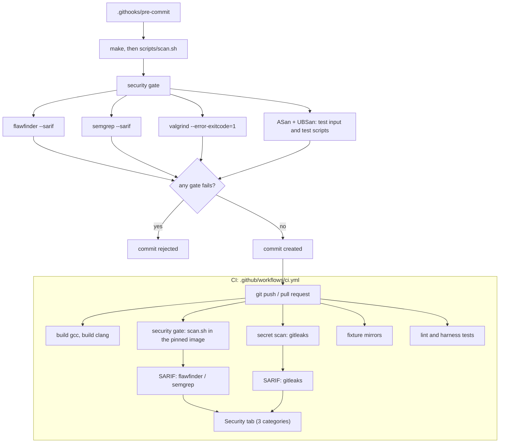

# c-secure-build

[](https://github.com/Arnaud1404/c-secure-build/actions/workflows/ci.yml)

A POSIX shell in C with four planted bugs, and a pipeline that finds them and blocks the commit until they are fixed. The shell only gives the scanners something to find. `./scripts/scan.sh` exits 1 at the `v2-vulnerable` tag and 0 at `v2-patched`, which differ only in the four fixes.



## Quick start

The gate needs Linux: native Windows has no ASan or Valgrind. The simplest route is the pinned image, with only Docker or Podman on the host:

```bash
make docker-scan                     # builds the image, runs the gate in it
make CONTAINER=podman docker-scan    # same, with Podman
```

In a Codespace, `.devcontainer/devcontainer.json` builds the same image: run `make test && ./scripts/scan.sh`.

On a Linux host, install gcc or clang, make, valgrind and the sanitizer runtimes, then the pinned scanners. `scripts/scan.sh` finds `.venv/bin` on its own.

```bash
python3 -m venv .venv
.venv/bin/pip install -r requirements.txt

make                  # hardened build with ASan/UBSan
make ASAN=0 all       # without sanitizers
make VALGRIND=1       # for Valgrind, which cannot run an ASan binary
make test             # behaviour tests, under ASan/UBSan
make scan             # the gate
make hooks            # install the pre-commit hook
```

Switching between the three builds needs `make clean`: Make compares timestamps and cannot see that a variable changed. `make test` and `make scan` clean on their own.

To watch the gate flip:

```bash
git checkout v2-vulnerable && ./scripts/scan.sh   # exits 1, blocked
git checkout v2-patched    && ./scripts/scan.sh   # exits 0, clean
```

Each tag carries its own copy of the gate, so this is the verdict that tag got at the time.

### Exit codes of `scripts/scan.sh`

| Exit | Meaning |
|---|---|
| 0 | Nothing blocked |
| 1 | A finding blocked |
| 2 | Nothing was scanned: a missing scanner, a failed build, an engine that wrote no report, or a block pass that crashed |

The hook and CI call the script directly, because Make reports every recipe failure as its own exit 2 and would turn a finding into what looks like a broken toolchain.

## The target

A REPL that reads a line, splits it on whitespace, forks and calls `execvp`, plus a `history`/`recall` feature that carries the planted defects.

| Version | File | Built and scanned |
|---|---|---|
| vulnerable | [`src/vuln_shell.c.bak`](src/vuln_shell.c.bak), byte-for-byte mirror of `v2-vulnerable`, so the line numbers in `docs/` resolve at `HEAD` | no |
| hardened | [`src/hardened_shell.c`](src/hardened_shell.c), started as `v2-patched` and refactored since | yes |

Neither static engine parses `.bak` as C. Renamed to `.c`, `make scan` blocks. `v2-patched` fixes all four defects in 15 insertions and 9 deletions. The shell is not meant to be a secure shell.

The fixtures are tags because a branch would be a second head to maintain, and one accidental merge would replant the bugs in `main`.

## The gate

| Engine | Kind | What it does here |
|---|---|---|
| Flawfinder | Lexical | Matches dangerous API names against a fixed list |
| Semgrep | Syntactic | 49 vendored rules from [0xdea/semgrep-rules](https://github.com/0xdea/semgrep-rules) (MIT), plus this project's ban list |
| Valgrind | Dynamic | Leak and error detection at runtime, on the test input |
| ASan + UBSan | Dynamic | Instrumented build run on the test input and both test scripts, with LeakSanitizer |

Each static engine runs twice. The first pass writes `.security/*.sarif` with every finding down to `note`. The second runs at the tool's own error threshold, and its exit code is the verdict. A clean gate still ships a full report.

[`.semgrep/local/banned-apis.yaml`](.semgrep/local/banned-apis.yaml) raises `atoi`/`atol`/`atoll`/`atof`, `strtok` and `tmpnam`/`tempnam`/`mktemp` to `ERROR`, on top of what the vendored pack blocks. `semgrep --test .semgrep/local/` checks the rules.

### Which engine sees which defect

All four compile cleanly under `-Wall -Wextra -Werror -pedantic -Wformat-security` on gcc and clang, so they all reach the scanners.

| | Defect | CWE | Flawfinder | Semgrep | Valgrind | ASan |
|---|---|---|---|---|---|---|
| C1 | `strcpy` of the input line into a 32-byte global | 120/787 | error | error | not triggered | not triggered |
| C2 | `history` passes its argument to `printf` as the format | 134 | error | error | silent | silent |
| C3 | Recall ring overwrites `strdup`ed entries without freeing | 401 | silent | silent | definitely lost | LeakSanitizer |
| C4 | Occupancy flags from `malloc` where `calloc` was meant | 457 | silent | silent | conditional jump | silent, exit 0 |

- C3 and C4 are invisible to both static engines.
- C4 is why the pipeline runs Valgrind as well as ASan: uninitialised reads are MemorySanitizer's job, and it cannot be combined with `-fsanitize=address`.
- C1 is not triggered because the test input never types a long line. If it did, `_FORTIFY_SOURCE` would kill the process before C3 and C4 happen, and one defect would hide the other two dynamic reports. The report measures that case.

### The delta from `v2-vulnerable` to `v2-patched`

| Signal | `v2-vulnerable` | `v2-patched` |
|---|---|---|
| `./scripts/scan.sh` | 1, blocked | 0, clean |
| Flawfinder / Semgrep block pass | 1 / 1 | 0 / 0 |
| Valgrind / ASan | 7 / 1 | 0 / 0 |
| Findings, total | 23 | 23 |
| Findings at `error` | 4 | 0 |

The total stays at 23 because the gate reads severity, not count: most are `note`-level hits on fixed-size arrays and audit-candidate calls. Full writeup: [`docs/security-report-v2-vulnerable.md`](docs/security-report-v2-vulnerable.md). `scripts/collect_security_data.sh` rebuilds this dataset for any two refs, with today's rules, so `v2-patched`, which still calls `atoi`, now blocks there.

## CI

| Job | What it does |
|---|---|
| `build (gcc)`, `build (clang)` | Hardened build under both compilers |
| `security gate` | `scripts/scan.sh` in the pinned image, then one SARIF upload per engine. A `*-vulnerable` tag that passes fails the job |
| `secret scan` | `gitleaks` over the full history |
| `fixture mirrors` | Asserts `src/vuln_shell.c.bak` still matches `v2-vulnerable` |
| `lint and harness tests` | shellcheck, ruff, and pytest on `llm-eval/tests` |
| `security-data release` | On `v*` tags, after the gate: attaches `security-data-<tag>.zip` to a release |

Third-party actions are pinned by commit SHA, downloaded tools by SHA-256. The image pins `ubuntu:24.04` by digest and reads the Ubuntu snapshot archive at a fixed date (gcc 13.3, valgrind 3.22).

Branch protection on `main` requires `build (gcc)`, `build (clang)`, `security gate` and `secret scan`, for admins too.

## Hardening

| Flag | Why |
|---|---|
| `-Wall -Wextra -Werror -pedantic` | Warnings are build failures, strict ISO C17 |
| `-D_FORTIFY_SOURCE=3` | Runtime bounds checks on libc calls whose sizes the compiler cannot prove |
| `-fPIE` / `-pie` | ASLR applies to the binary itself |
| `-fstack-protector-strong` | Stack canaries on functions with local arrays or address-taken locals |
| `-Wformat-security` | Warns on a non-literal format string with no arguments |
| `-Wl,-z,relro,-z,now` | Full RELRO: the GOT is resolved at load time and mapped read-only |

`explicit_bzero` wipes the `getline` buffer and the history copies before they are freed, because they hold anything typed at the prompt. Buffers that `getline` released while growing are not wiped.

## LLM triage (`llm-eval/`)

The scanners flag many lines that are not bugs. `llm-eval/` measures whether a local model can sort them, on 117 Juliet findings (50 real, 67 false positives) whose labels no model produced. With thinking on, gemma-4-E4B reaches 85.0% balanced accuracy against a 65.6% naive Bayes floor: as a filter it removes 55 of the 67 false positives and wrongly dismisses 6 of the 50 real bugs. Claude, as a reference, reaches 98.3%. Details in [`llm-eval/README.md`](llm-eval/README.md), numbers in [`llm-eval/results_v2/report.md`](llm-eval/results_v2/report.md).

## Limits

- Four defects I wrote in one program show how the tools differ. They give no detection rate.
- Dynamic engines only see what the test input exercises.
- The pre-commit hook scans the working tree, not the staged content, so unstaged fixes can make a bad commit pass. Anyone can also pass `--no-verify`. CI is the authority.
- The LLM filter is not wired into the gate, and its set is synthetic Juliet code.
- `requirements.txt` pins the scanners but not their dependencies, and the release job runs the collector on the runner, not in the image.
- Automated blocking is part of what the Cyber Resilience Act and NIS2 expect, but nothing here is mapped to articles and there is no SBOM or build provenance, so this is no compliance claim.

## Layout

```
src/hardened_shell.c      the target: built, scanned, gated
src/vuln_shell.c.bak      mirror of v2-vulnerable; not built, not scanned
tests/                    test input for the dynamic engines, recall and shell behaviour tests
scripts/scan.sh           the gate
scripts/collect_security_data.sh  before/after dataset for two refs
docs/                     security report
.semgrep/rules/           vendored pack and NOTICE
.semgrep/local/           this project's ban list and its rule tests
.githooks/pre-commit      installed by make hooks
.github/workflows/ci.yml  jobs listed above
Dockerfile                pinned toolchain image
llm-eval/                 LLM triage benchmark, results and harness tests
AGENTS.md                 rules and commands for coding agents
```

## References

- [POSIX.1-2008 Process Execution](https://pubs.opengroup.org/onlinepubs/9699919799/)
- [GCC Instrumentation Options](https://gcc.gnu.org/onlinedocs/gcc/Instrumentation-Options.html)
- [SARIF 2.1.0 specification](https://docs.oasis-open.org/sarif/sarif/v2.1.0/sarif-v2.1.0.html)
